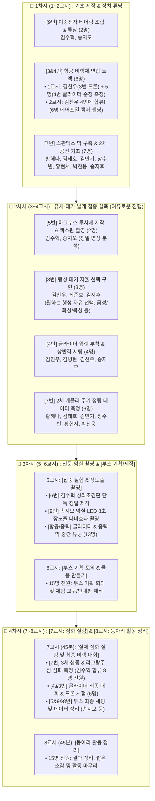

# 🪐 과학동아리 [코스모스] 4차시(총 8교시) 실험 운영 계획표

> **피드백 완벽 반영**:
> 1. **4차시 2교시(8교시) 명칭 심플화**: 거창한 이름 대신 **`[동아리 활동 정리]`**로 간결하게 정리!
> 2. **8번 행성 대기 자율 선택제**: 금성/목성 고정이 아니라, **조별로 탐구하고 싶은 태양계 행성(금성, 화성, 목성, 타이탄 등)을 자유롭게 선택**하여 고유 대기 특성 모델링!
> 3. **4차시 1교시(7교시)를 실제 심화 실험 시간으로 배정**: 7번 3체 섭동 최종 측정 & 4번 글라이더 최종 활공비 챔피언십 및 드론 시험 진행!
> 4. **과밀 스케줄 대폭 완화 및 여유로운 분산**: 2차시에 몰려있던 6번(성좌조견판)과 9번(암실 장노출)을 3차시 5교시로 분산하여 전 부원이 쫓기지 않고 깊이 있게 탐구 가능!

---

## 👥 1. 화이트보드 기준 실제 선택 인원 명단 (100% 일치)

| 번호 | 실험 주제 | 실제 선택자 명단 | 인원수 | 역할 분담 및 운영 전략 |
| :---: | :--- | :--- | :---: | :--- |
| **3번** | **비행체 역학** | **김찬우** | 1명 | 1차시 드론 기초 → 4차시 1교시 드론 외란/하중 심화 시험 |
| **4번** | **날개 개조** | **김찬우, 김진우, 최준호, 김병현, 김선우, 김시후, 송지후** | 7명 | 1차시 에어포일 깎기 → 2차시 윙렛 개조 → 4차시 1교시 최종 챔피언십 |
| **5번** | **마그누스 효과** | **송지오, 김수혁** | 2명 | 2차시에 종이컵 롤러 & 딤플 골프공 백스핀 궤적 여유롭게 정밀 촬영 |
| **6번** | **별자리 지도** | **김수혁** *(단독)* | 1명 | 3차시 5교시에 북위 37.5° 성좌조견판 정밀 제작 및 시차 실습 집중 진행 |
| **7번** | **시리우스 중력** | **김수혁, 황해나, 김태호, 김민기, 장수빈, 황현서, 송지후, 박찬웅** | 8명 | 1~2차시 탄성막/2체 공전 실측 → 4차시 1교시에 김수혁 합류 3체 섭동 완결 |
| **8번** | **행성 대기** | **김수혁, 김찬우, 김시후, 최준호** | 4명 | **조별 원하는 행성 자율 선택!** (금성 온실효과 / 목성 소용돌이 / 화성 대기 등) |
| **9번** | **카오스 이중진자**| **김수혁, 송지오** | 2명 | 1차시 베어링 조립/튜닝 → 3차시 5교시 암실 LED 장노출 나비효과 촬영 |

---

## 🗓️ 2. 차시별(1차시~4차시, 총 8교시) 로드맵 다이어그램

---

### 📍 [1차시] (1~2교시): 기초 제작 & 장치 튜닝

| 트랙 구분 | 실험 주제 및 활동 내용 | 참여자 명단 | 세부 활동 및 목표 |
| :--- | :--- | :---: | :--- |
| **Track A** | **[9번] 카오스 이중진자 ①** (베어링 조립 & 회전 튜닝) | **2명** (김수혁, 송지오) | • 608zz 베어링 2개, 아크릴 바, M8 볼트 결합 • 회전축 유격 제거 및 마찰 극소화 튜닝, 초소형 LED 칩 부착 |
| **Track B** | **[3번 & 4번] 항공 비행체 연합 트랙** (드론 기초 + 글라이더 에어포일 샌딩) | **6명 (통합)** (김찬우, 김진우, 김병현, 김선우, 김시후, 최준호) | • **1교시 (분담 진행)**:   - **김찬우**: [3번] 종이비행기 CG 이동 & 드론 기초 호버링/외란 테스트 완료   - **5명 (김진우, 김병현, 김선우, 김시후, 최준호)**: [4번] 순정 글라이더 3회 기준 비행 측정 및 에어포일 샌딩 시작 • **2교시 (합류 진행)**:   - **김찬우가 4번에 합류 (총 6명)**: 주날개 윗면 캠버 곡면 가공 완성 및 1차 개조 날개 활공비 측정 |
| **Track C** | **[7번] 시리우스 중력 ①** (스판덱스 막 구축 & 2체 공전) | **7명** (황해나, 김태호, 김민기, 장수빈, 황현서, 박찬웅, 송지후) | • **설치조 (황해나, 장수빈, 황현서)**: 훌라후프에 스판덱스 천 클램프 균일 고정 • **공전조 (김태호, 김민기, 박찬웅, 송지후)**: 대형-중형 구슬(2:1 질량비) 공통 질량중심 회전 촬영 |

---

### 📍 [2차시] (3~4교시): 유체·대기·날개 집중 실측 (여유로운 스케줄)

| 트랙 구분 | 실험 주제 및 활동 내용 | 참여자 명단 | 세부 활동 및 목표 |
| :--- | :--- | :---: | :--- |
| **Track A** | **[5번] 마그누스 효과 (집중 실측)** (자율 투사체 제작 및 백스핀) | **2명** (김수혁, 송지오) | • 종이컵 롤러(매끄러운 면 vs 사포 부착) & 딤플 골프공 제작 • 고무줄 백스핀 런처 발사, 격자판 배경 고속영상 궤적 정밀 촬영 |
| **Track B** | **[8번] 행성 대기 구현 (행성 자율 선택)** (조별 원하는 행성 고유 대기 모델링) | **3명** (김찬우, 최준호, 김시후) | • **[조별 원하는 행성 자유 선택]**:   - **선택 A (김찬우, 최준호)**: 온실효과 모델링 (금성의 폭주 CO2 온실효과 또는 화성의 희박 대기 복사평형 선택 → 램프 가열/냉각 실시간 온도 측정)   - **선택 B (김시후)**: 대기 소용돌이 모델링 (목성의 대적점 또는 토성의 제트기류 선택 → 회전 수조 펄 안료 전단 와류 시각화) |
| **Track C** | **[4번] 글라이더 개조 ②** (윙렛 장착 & 상반각 조절) | **4명** (김진우, 김병현, 김선우, 송지후) | • 주날개 끝 폼보드 수직 윙렛 부착 • 주날개 결합부 완만한 V자 상반각 세팅 및 꼬리날개 플랩 절개 완료 |
| **Track D** | **[7번] 시리우스 중력 ②** (2체 케플러 주기 정량 측정) | **6명** (황해나, 김태호, 김민기, 장수빈, 황현서, 박찬웅) | • 2:1 질량비에 따른 공전 궤도 반경 실측 • 공전 주기(P)와 거리(a) 데이터 기록 및 케플러 제3법칙 검증 |

---

### 📍 [3차시] (5~6교시): 천문·암실 촬영 & [과학 체험 부스 기획 및 제작]

| 시간 구분 | 트랙 및 활동 내용 | 참여자 명단 | 세부 활동 및 목표 |
| :---: | :--- | :---: | :--- |
| **5교시** (45분) | **Track A [6번 별자리 지도 (단독)]** | **1명 (김수혁)** | • 북위 37.5° 성좌조견판 정밀 오리기/할핀 결합 & 3분 56초 시차 계산 실습 |
| | **Track B [9번 카오스 이중진자 ②]** | **1명 (송지오)** | • 암실 조성 후 스마트폰 8초 장노출로 동일 90도 각도 3회 방출 나비효과 촬영 |
| | **Track C [항공 & 중력 중간 튜닝]** | **13명 (나머지 부원)** | • 글라이더 날개 밸런스 튜닝 및 중력막 3체 섭동 사전 테스트 |
| **6교시** (45분) | **[과학 체험 부스 기획 토의 & 물품 제작]** | **15명 전원** | • 15명 다 함께 부스 운영 아이디어 회의 (체험 미션, 룰 결정) • 부스 체험 교구, 안내/설명 판넬, 소모품 다 함께 제작 |

---

### 📍 [4차시] (7~8교시): [7교시: 실제 심화 실험 완결] & [8교시: 동아리 활동 정리]

| 시간 구분 | 트랙 및 활동 내용 | 참여자 명단 | 세부 활동 및 목표 |
| :---: | :--- | :---: | :--- |
| **7교시** (45분) *(실험 시간!)* | **Track A [7번 시리우스 다체 섭동 심화]** | **8명 (전원)** (김수혁 합류! 황해나, 김태호, 김민기, 장수빈, 황현서, 송지후, 박찬웅) | • **김수혁 7번 합류!** • 쌍성계 회전 상태에서 제3의 작은 구슬(행성) 투입 • 입사각/속도별 궤도 포획, 충돌, 슬링샷 이탈 궤적 정밀 촬영 및 완결 |
| | **Track B [4&3번 글라이더 최종 대회]** | **6명 (전원)** (김찬우, 김진우, 최준호, 김병현, 김선우, 김시후) | • **글라이더 최종 대회**: 순정 vs 에어포일 vs 윙렛 4개 기체 5회 활공비 측정 대결 • **드론 심화**: 기체 비대칭 하중 장착 시 자동 복원 한계선 측정 완결 |
| | **Track C [부스 최종 세팅 & 데이터 정리]** | **1명 (송지오)** | • 부스 체험대 최종 점검 및 5·9번 영상/사진 캡처 정리 |
| **8교시** (45분) | **[동아리 활동 정리]** | **15명 전원** | • 각 조별 실험 데이터 및 사진/영상 최종 취합 • 짧은 조별 활동 소감 공유 및 전체 동아리 활동 마무리 |
